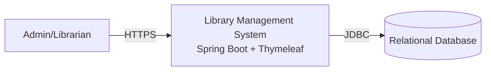
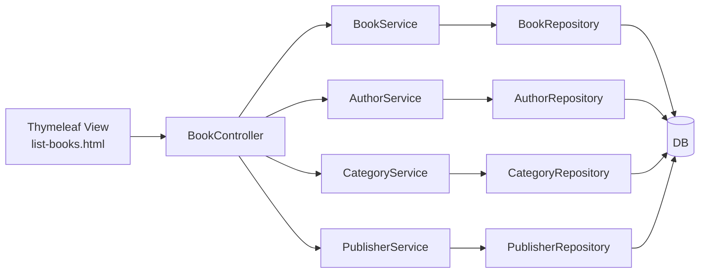

# Architecture Document (MLG1)

## 1. Purpose
This document defines the architecture for the **Library Management System** and the approved enhancements:
- **MLG1-9**: Add automated test coverage for core CRUD flows.
- **MLG1-10**: Add advanced search and filtering for the Books list (title + author/category/publisher filters).

## 2. System overview
The application is a **monolithic Spring Boot web application** providing server-side rendered UI (Thymeleaf) for administering a library catalogue.

### Primary features (existing)
- Authentication (Spring Security form login)
- CRUD: Books, Authors, Categories, Publishers
- CSV/Excel export (File export controller)

### New/changed capabilities
- Book list can be filtered by:
  - Title substring (case-insensitive)
  - Author (single author selection)
  - Category (single category selection)
  - Publisher (single publisher selection)
- Automated tests for repository and MVC layers.

## 3. Architectural drivers
### Functional drivers
- Usability: quickly find books in large catalogues.
- Correctness & stability: prevent regressions via automated tests.

### Non-functional drivers
- Maintainability: keep changes aligned with current package structure and Spring conventions.
- Performance: filtering must remain responsive for typical catalogue sizes.
- Security: preserve existing auth; do not expose new unauthenticated actions.

## 4. Technology stack (current + used)
- Java + Spring Boot
- Spring MVC + Thymeleaf templates
- Spring Data JPA (Hibernate)
- Spring Security (form login)
- Relational DB (configured externally; H2 in tests)
- JUnit 5 + Spring Boot Test (for MLG1-9)

## 5. Context diagram (C4 Level 1)


## 6. Container diagram (C4 Level 2)
```mermaid
flowchart TB
  user["Admin/Librarian"] -->|Browser| ui["Server-side UI\nThymeleaf Views"]
  ui -->|HTTP (Spring MVC)| app["Spring Boot Application\nControllers/Services/Repositories"]
  app -->|JPA/Hibernate| db[("Relational Database")]

  subgraph Testing
    tests["JUnit5 + Spring Boot Test\n@DataJpaTest, @WebMvcTest"] --> app
    tests --> dbt[("H2 In-Memory DB")]
  end
```

## 7. Component diagram (C4 Level 3 - logical)
Key components impacted by the enhancements:
- **BookController**: accepts query params and supplies filter data to the view.
- **BookService / BookServiceImpl**: adds `searchBooks(...)` method.
- **BookRepository**: adds a JPQL query to handle optional filters.
- **list-books.html**: adds filter form and clear action.
- **Test suite**: repository tests and MVC tests.



## 8. Data architecture
### Existing model
- `Book` has `@ManyToMany` relationships with `Author`, `Category`, `Publisher` using join tables:
  - `books_authors(book_id, author_id)`
  - `books_categories(book_id, category_id)`
  - `books_publishers(book_id, publisher_id)`

### Search/filter strategy
- Filter by title: `lower(b.name) like lower(concat('%', :title, '%'))`
- Filter by entity IDs: join to authors/categories/publishers and filter by selected id.
- Optional parameters handled in a single repository method using `(:param is null OR ...)` expressions.

## 9. Security architecture
- Existing Spring Security form login remains.
- Book list filtering occurs on the same endpoint and does not introduce new roles/permissions.
- MVC tests may need `@WithMockUser` if access to endpoints is restricted.

## 10. Observability & logging
- No new infra required.
- Recommend logging query parameters at debug level in controller (optional).

## 11. Quality strategy
### Testing approach (MLG1-9)
- Repository tests using `@DataJpaTest` + H2.
- MVC tests for controllers using `@WebMvcTest` + MockMvc.
- Focus on:
  - CRUD happy paths
  - Negative path for missing entities (and validation if implemented).

## 12. Deployment view
- Single deployable unit: Spring Boot jar.
- External DB for runtime environments; H2 used only for tests.

## 13. Risks & mitigations
- **Many-to-many joins can create duplicates** in filtered book results.
  - Mitigation: use `select distinct b` in JPQL.
- **CascadeType.REMOVE on authors in Book** might delete authors when book removed.
  - Existing behavior; tests should lock current behavior and identify risks.

## 14. Architecture decisions (ADRs - lightweight)
- Use JPQL with optional parameters for filtering (minimal change, aligned with Spring Data).
- Prefer Mermaid diagrams stored as code for version control and Confluence reuse.
